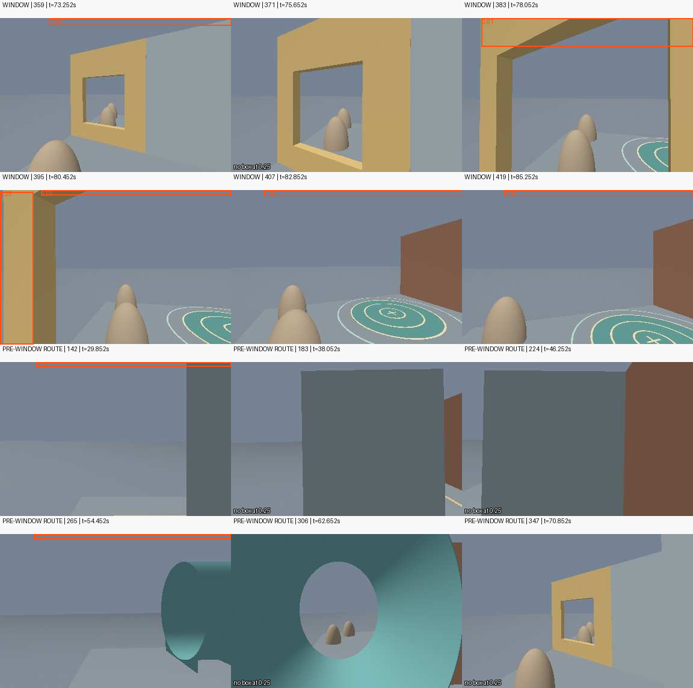

# Black Bee gate detector: simulated frame check

This is an offline, unannotated spot check of the publicly hosted [Black Bee IMAV 2025 gate model](https://huggingface.co/blackbeedrones/imav-2025-gate). It is a gate detector, not a net detector, and it has not been integrated into this project. The competitor describes its broader system in the [IMAV 2025 repository](https://github.com/Black-Bee-Drones/imav-2025).

## Result

At the team-reported confidence threshold of **0.8**, the detector returned **0 boxes on all 6 selected WINDOW frames** and **0 boxes on all 6 selected pre-window route frames**. At the diagnostic threshold of **0.25**, it returned 6 boxes across 5/6 WINDOW frames and 2 boxes across 2/6 route samples. The route images were selected from the pre-window segment, but the frame index does not store phase labels; they are not verified negative examples.

| Group | Frame @ sim time | Boxes at 0.25 (confidence; xyxy pixels) | Boxes at 0.8 |
|---|---:|---|---:|
| WINDOW | 359 @ 73.252s | 0.298; [81.8, 0.0, 384.0, 12.98] | 0 |
| WINDOW | 371 @ 75.652s | none | 0 |
| WINDOW | 383 @ 78.052s | 0.606; [32.71, 0.0, 384.0, 47.5] | 0 |
| WINDOW | 395 @ 80.452s | 0.582; [68.1, 0.0, 383.63, 8.31]; 0.251; [0.0, 3.68, 55.89, 256.0] | 0 |
| WINDOW | 407 @ 82.852s | 0.430; [55.71, 0.0, 384.0, 9.68] | 0 |
| WINDOW | 419 @ 85.252s | 0.502; [69.0, 0.0, 384.0, 9.53] | 0 |
| Pre-window route sample | 142 @ 29.852s | 0.304; [60.66, 0.0, 384.0, 7.66] | 0 |
| Pre-window route sample | 183 @ 38.052s | none | 0 |
| Pre-window route sample | 224 @ 46.252s | none | 0 |
| Pre-window route sample | 265 @ 54.452s | 0.534; [56.52, 0.0, 383.81, 7.95] | 0 |
| Pre-window route sample | 306 @ 62.652s | none | 0 |
| Pre-window route sample | 347 @ 70.852s | none | 0 |

The simulated detections at 0.25 are mostly thin boxes touching the top image edge. Exact OpenCV preprocessing did not change any detection count or move any result across 0.8 compared with the prior Pillow pass. For example, frame 359’s top raw prediction maps through inverse letterbox to y = −62.75…12.98 px, then clips to y = 0…12.98 px. This supports the observation that the top strip comes from the model prediction extending into letterbox padding; it is not evidence that the opening was detected.

Counts are model outputs only. There are no ground-truth annotations here, so these are not precision, recall, or accuracy measurements. The model was not used for navigation and is not integrated.

## Reproducibility and decoding

The downloaded ONNX is pinned to revision `07b604bd74fb49790f9e3db348e4826f524b4654` with SHA-256 `7a88274eff0538c019937b710630abd5efef89674e2afd5a9e82fcca753b8757`. It was evaluated locally with ONNX Runtime 1.27.0, CPUExecutionProvider, NumPy 2.4.6, and the existing local PlatformIO Python environment. OpenCV 4.13.0 via `/usr/bin/python3` produced the exact letterboxed inputs; no packages were installed.

OpenCV preprocessing follows the pinned Ultralytics v8.3.152 path: resize with `INTER_LINEAR`, preserve aspect ratio and center-pad to 640×640 using RGB 114; convert BGR to RGB, transpose to BCHW, cast to float32, and divide by 255. ONNX metadata exposes `[1,3,640,640]` input and raw `[1,5,8400]` output with `nms=False`. The official YOLO Detect head concatenates decoded `xywh` coordinates with sigmoid class scores along the channel axis; inference transposes to `[8400,5]`, applies single-class NMS at IoU 0.7, then undoes letterbox scale/padding and clips boxes to the source image.

Primary implementation references: [Ultralytics letterbox](https://github.com/ultralytics/ultralytics/blob/v8.3.152/ultralytics/data/augment.py), [predictor preprocessing](https://github.com/ultralytics/ultralytics/blob/v8.3.152/ultralytics/engine/predictor.py), [YOLO Detect output](https://github.com/ultralytics/ultralytics/blob/v8.3.152/ultralytics/nn/modules/head.py), and [default NMS IoU](https://github.com/ultralytics/ultralytics/blob/v8.3.152/ultralytics/cfg/default.yaml). Per-frame input hashes, raw detections, and method details are in [competitor-gate-check.json](competitor-gate-check.json).

## License metadata

The Hugging Face model card labels the repository Apache-2.0, while this ONNX file’s custom metadata says AGPL-3.0. The labels conflict; this report makes no legal interpretation. No model weights or competitor mission source are included here.
