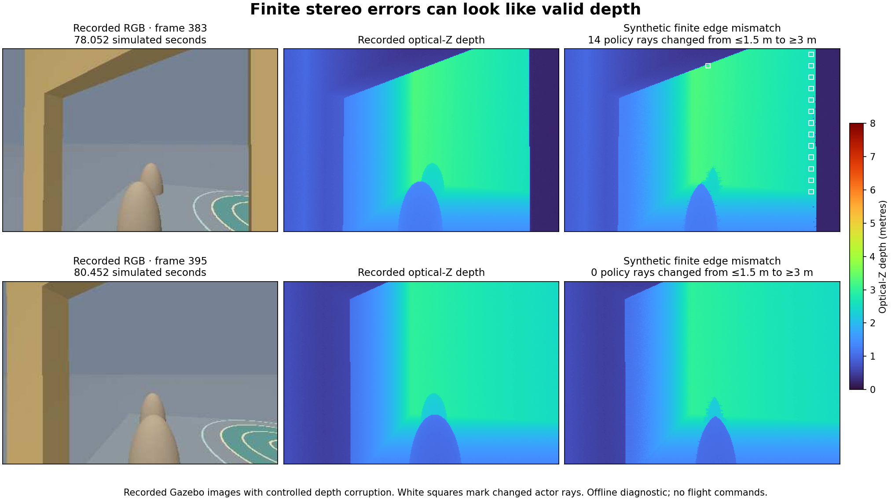

# Forward RGBD noise diagnostic

This opt-in SITL trial adds zero-mean Gaussian noise with 0.010 m standard deviation to the forward RGBD depth render. It keeps the downward range sensor, camera geometry, route, airframe, PX4 settings, and frozen checkpoint fixed. `SIM_RGBD_DEPTH_NOISE=off` is the default. Use `control` and `gaussian-10mm` for the paired diagnostic. Both use Gazebo server seed `4417`.

The first unarmed paired capture passed all five static checks. Across 24 frames per case, the selected wall patch had **9.81 mm added temporal standard deviation**, zero measured variation in the control, and 3.96 mm 95th-percentile mean-depth shift. This verifies that the injected noise reached the depth topic used for navigation. It does not establish flight robustness or reproduce stereo-camera failures. The [capture hashes, world provenance, and measurements](depth-noise-results.json) are retained with the result.

On the patched PX4 image, a second paired capture measured 9.87 mm added variation and passed the same checks. **The first noisy hover then failed** 5.300 simulated seconds after arming: survey and relative depth registration lost enough correspondences to stop tracking, and RGB fallback could not recover it. It accepted no learned actions. PX4 landed and disarmed 4.700 seconds after the fault; offline geometry scoring certified the post-fault path clear of modeled course obstacles, permitting floor contact. The [failed trial and abort evidence](noisy-hover-results.json) are preserved. No noisy full-route success is established by this test.

The exact rejected capture exposed noisy surface normals: 1,778 sampled points were close to the surveyed geometry, but only 621 passed normal alignment, below the unchanged 40% overlap gate. Survey matching now estimates the source normal across ±2 pixels while retaining the measured center depth. It checks the existing curvature limit at both ±1 and ±2 pixels, rejecting the tested depth steps, missing strips and thin strips. The exact rejected frame then fit with 848/1,381 matches and a 5.72 mm plane residual. The approximate 5 Hz archive replay accepted 115/115 frames, compared with 113/115 before the change. These are offline observations; the archive does not contain every original 20 Hz frame.

This wider derivative is deliberately limited to the static survey, whose target normals come from geometry. Widening relative frame-to-frame target normals falsely accepted six of 24 independent noisy single-plane pairs, so the fallback and its stored frames keep their original ±1 derivative. Neither registration thresholds nor the policy's raw depth input changed. An exact surveyed plane still fails the observability check. The [replay and counterexample report](noisy-depth-replay.json) records the inputs, source hashes and limits. A 72-frame in-container timing probe measured 27.2 ms median and 33.9 ms 95th-percentile noisy-frame processing; transport and scheduling are excluded, and this is not a Jetson benchmark.

With the fix, a fresh noisy hover completed in **20.000 simulated seconds through landing and disarm**, including three seconds of settled hover. The independent observer certified its modeled path clear and touchdown inside the pad. The [hover repeat](noisy-hover-repeat-results.json) preserves its distinct run ID and executable, world and estimator hashes. This checks the takeoff/hover/landing sequence; full-route robustness requires a separate flight.

The subsequent **policy-06 full-route attempt failed in the maze** at 33.340 simulated seconds after arming, with 120 learned actions and 5/15 independently verified waypoints. Its survey match passed overlap but failed the unchanged observability gate (0.002833 versus 0.004 required); depth and RGB fallback also failed. PX4 confirmed landing and disarm 5.660 seconds after the fault. Offline scoring certified the abort path clear of modeled obstacles, with floor contact permitted. The [failed policy trial](noisy-policy-results.json) remains in the complete trial inventory. The successful noisy hover therefore does not establish noisy route completion.

## Policy-07 noisy route

Policy-07 later completed one full route with the packaged v1 policy on patched PX4. It flew 78.000 simulated seconds from arming through confirmed touchdown/disarm, reached 15/15 ordered truth waypoints, crossed the aperture with the inflated multipart x500 envelope, and passed all eight independent checks. The minimum modeled aperture clearance was 100.9 mm, including the configured 15 mm envelope margin. The run used zero-mean Gaussian depth noise with 10 mm standard deviation and the opt-in FALS7 survey-normal estimator. The [result record](noisy-policy-completed-results.json) includes the configuration, source hashes, score, and sensor archive hashes; the [RGB/depth replay](media/window-policy-noisy.mp4) is captured from the run.

This is a single synthetic-noise Gazebo/PX4 success, not a robustness estimate or evidence for OAK stereo or physical transfer. Contact coverage was partial: the base-link stream carried messages, while rotor topics were advertised but had no messages observed. Silence does not establish zero contacts. The newer 120 ms capture-gap condition was not included in this run. A subsequent nominal-depth control, policy-08, completed with that limit and FALS7 in 78.000 simulated seconds, passed all eight checks, and had 92.3 mm modeled window clearance. Its [separate result record](fals7-control-results.json) includes the preceding 20-second hover proof. A noisy repeat with that same continuity limit is still required. The earlier policy-06 observability failure and noisy-hover failure above remain part of the record.

## OpenCV normal estimator candidate

`--survey-normals fals7` selects OpenCV's existing FALS estimator for absolute survey matching. The default remains `central2`; course and policy runs require a completed hover using the same choice. FALS uses a cached 7×7 neighborhood and an 8-pixel survey sampling stride. Measured center depths, relative depth registration, and the registration thresholds remain unchanged. The original tight ±1/±2 center curvature checks remain; an additional 7×7 support mask rejects invalid returns and coarse depth discontinuities. Run metadata records both thresholds, the support size and OpenCV version. The runtime container already supplies OpenCV 4.6 contrib; CI uses the pinned contrib headless wheel. [OpenCV API](https://docs.opencv.org/4.6.0/d1/d5b/classcv_1_1rgbd_1_1RgbdNormals.html) · [OpenCV implementation](https://github.com/opencv/opencv_contrib/blob/4.6.0/modules/rgbd/src/normal.cpp)

The exact failed maze capture retained only two independent divider-wall matches with `central2`. FALS recovered the same raw capture with a 2.24 mm position error measured after fitting. In a targeted noisy-view test, it accepted 21/28 perturbed cases, with all accepted errors below 3.4 mm; the other cases failed observability. A separate replay seeded from the preceding recorded sensor estimate accepted all 241 tested noisy captures and all 74 nominal window-section captures. These seeded tests do not establish continuous tracking. In strict replay from launch, both methods lost track at the downsampled 5 Hz archive cadence and accepted some wrong poses before failure. Fresh native-rate hover and course trials are required before promoting this option.

The wrapper inserts `<camera><noise>` only in the generated `/tmp/dronehacks-px4.sdf` before Gazebo starts. The navigation audit hashes that exact world and the unchanged recursively included models. The mode, seed, configured renderer, topic, and before/after world hashes are recorded in `/tmp/dronehacks-rgbd-depth-noise.json` and printed at startup. The seed makes the setup reproducible, while actual image bytes depend on the renderer and execution order.

Gazebo Harmonic reads the camera Gaussian noise setting and attaches it to the RGBD depth camera's Ogre2 render path. This tests sensitivity to idealized depth noise. Stereo disparity confidence, missing returns, and occlusion-edge behavior require separate measurements. [SDFormat camera schema](https://sdformat.org/spec/1.10/sensor/#sensor_camera_noise) · [Harmonic RGBD sensor source](https://github.com/gazebosim/gz-sensors/blob/gz-sensors8/src/RgbdCameraSensor.cc#L315-L334) · [Ogre2 depth noise source](https://github.com/gazebosim/gz-rendering/blob/gz-rendering8/ogre2/src/Ogre2DepthCamera.cc#L1282-L1306) · [Luxonis StereoDepth](https://docs.luxonis.com/software-v3/depthai/depthai-components/nodes/stereo_depth)

## Unarmed static verification

Use the dedicated marker-free simulator and a new evidence directory. The following Bash commands recreate that simulator twice. Run them only after any active run has landed and disarmed. Keep the launch fixture stationary and unarmed for both captures.

```bash
evidence=artifacts/markerfree/rgbd-noise-static-01
mkdir "$evidence"
docker_context=${SIM_DOCKER_CONTEXT:-colima-dronehacks-sim}
sim_container=dronehacks-markerfree-sim-1

capture_noise_case() {
    local noise_case=$1
    SIM_RGBD_DEPTH_NOISE="$noise_case" ./runtime/run-markerfree.sh || return
    docker --context "$docker_context" exec "$sim_container" \
        python3 -m vision.capture_rgbd --frames 24 --timeout 45 \
        --output "/workspace/$evidence/$noise_case.npz" || return
    docker --context "$docker_context" exec "$sim_container" \
        cat /tmp/dronehacks-rgbd-depth-noise.json > "$evidence/$noise_case.config.json" || return
    docker --context "$docker_context" exec "$sim_container" \
        python3 -m mission.navigation_audit > "$evidence/$noise_case.audit.json"
}

capture_noise_case control && capture_noise_case gaussian-10mm
```

The two raw float32 depth captures are taken from `/dronehacks/rgbd/depth_image`, which supplies navigation. Use a Python environment with NumPy to verify them.

```bash
python3 -m tools.check_gazebo_depth_noise verify "$evidence"
```

The default image patch starts at pixel `(176, 64)` and spans `32 × 32` pixels. This patch looked at a planar wall in the earlier launch captures. If the frame differs, use `--patch X Y W H` with a finite planar patch common to both captures and record its coordinates. The check requires an audit match for each configured world, an unchanged include graph, a stable planar control, consistent mean depths, and 6–16 mm of added temporal depth variation. It writes `verification.json` and exits nonzero on failure. Preserve both NPZ files, manifests, audits, and the report with the trial. The ordinary flight PNG archive quantizes depth to millimeters.

Proceed to a noisy flight only after the static check passes. Preserve the same `gaussian-10mm` config and compare with a matched `control` flight using the same checkpoint and route. Score waypoint order, envelope clearance, the window crossing, and landing with the independent observer. Keep simulator state separate from navigation.

## Matched runs with the tighter continuity limit

Policy-08 (nominal depth) and policy-09 (10 mm Gaussian depth noise) both used FALS7, the same packaged v1 actor, the boundary guard, patched PX4, and a 120 ms capture-gap limit with a separate 300 ms processing-age limit. Both completed in 78.000 simulated seconds and passed all eight independent route/geometry/landing checks. Minimum modeled aperture clearance was 92.3 mm for the control and 95.3 mm for the noisy trial. PX4 position RMSE against the independent observer was 5.12 mm and 5.01 mm, respectively. The similar outcomes in this pair do not estimate failure probability. [Control evidence](fals7-control-results.json) · [Noisy evidence](fals7-noisy-120ms-results.json) · [Noisy replay](media/window-policy-noisy-120ms.mp4).

## Structured stereo errors

A separate offline replay tested eight fixed views, five depth perturbations and three small sensor-prior offsets, for 120 cases. Preserved occlusion holes were rejected by the policy. Finite farther-depth substitutions at edges were admitted and produced six survey poses with more than 30 mm error, peaking at 33.17 mm; none exceeded the preregistered 60 mm threshold. Those six cases were three offsets at two window views. Another view changed 14 peripheral actor rays from at most 1.5 m to at least 3 m while raw input coverage remained 1.0. This shows why reported coverage and fit residual alone cannot establish trustworthy stereo depth. The [fixed protocol, complete results and methods](experiments/stereo-stress-01/methods.md) distinguish native captures, archived PNGs, synthetic stereo assumptions and independent scoring.

The paired actor check held the estimated state, waypoint and speed cap fixed for six window captures. Its largest velocity-vector change was 0.00700 m/s; the view with 14 changed rays increased its forward request by 0.00419 m/s. These are [open-loop output sensitivities](experiments/stereo-actor-sensitivity-01/methods.md), not closed-loop clearance results. The existing training dropout substitutes maximum range, so it stresses false clear returns without preserving an explicit unknown-pixel state. Neither experiment establishes real OAK stereo behavior.


